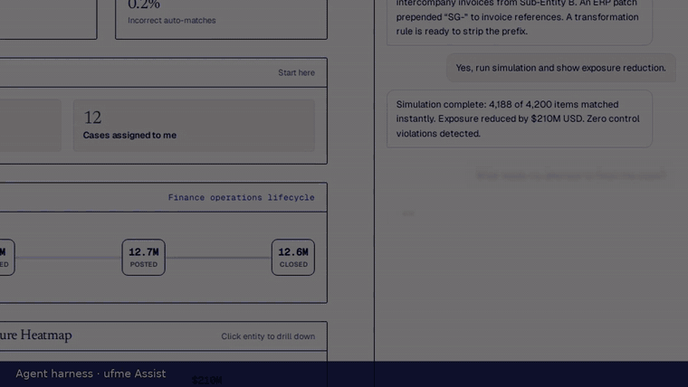

# ufme

**Open-source intercompany reconciliation.** ufme matches the transactions that a group's entities book with
each other, explains every match, sends the uncertain ones to a reviewer, and keeps an audit trail an external
auditor can verify.

Built and maintained by **[Arghya Chakraborty](https://github.com/arghyachaks)**. Licensed under
[Apache 2.0](LICENSE); please keep the [NOTICE](NOTICE) when you redistribute it.

[](docs/media/ufme-demo.mp4)

**[▶ Watch the full 2-minute narrated demo](docs/media/ufme-demo.mp4)** (opens GitHub's video player): every screen,
the transparent agents, human approval, and the agent operations control room.

---

## What it does

- **Matches at scale.** Exact, fuzzy-reference, FX-aware, timing-tolerant, one-to-many and many-to-many matching
  across every entity pair; 690K ledger lines in about 7 minutes on a laptop.
- **Knows when it is sure.** A learned, monotonic scorer with calibrated probabilities and an auto-match
  threshold that is *proven* (Clopper-Pearson) to keep auto-match errors under 0.5% at 95% confidence.
  Everything else goes to a person, with the reason.
- **Explains itself.** Each suggestion shows its drivers, what would have made it an auto-match, and why the
  amounts differ (withholding tax, bank fee, FX, rounding).
- **Learns from your reviewers.** Accept/reject decisions train a tenant-specific model, which must pass a
  promotion gate and be approved by a Controller before it is used. One-click rollback; drift monitoring.
- **Works the way controllers work.** Review queue, approval matrix by exposure, segregation of duties, dual
  control above 1M, manual matching within tolerance, cases, period sign-off.
- **Audit-ready.** Tamper-evident hash-chained audit trail, signed evidence packages, SOX controls computed
  from data.
- **Secure by default.** OIDC sign-in (Keycloak locally), entity-scoped access, Postgres row-level security
  between tenants.
- **Transparent agents, humans in charge.** ufme Assist and the Recon Investigator are agents (LangChain Deep
  Agents) that stream their thinking, plan, to-do list and every step. They only read and propose: every change
  waits for a person with the right role, then goes through the normal approval matrix.
- **Any LLM.** Local Ollama by default (nothing leaves your machine); OpenAI, Azure OpenAI, Anthropic, Gemini,
  Bedrock, Vertex, Mistral or any OpenAI-compatible server by configuration. Hosted models need a Finance
  Director's approval; an Agent operations page shows usage, cost, anomalies and data egress.

## Results on the benchmark

Measured on a 100,000-line synthetic group ledger with known ground truth (21 real-world scenarios: FX source
differences, withholding tax, bank fees, timing lags, split payments, reference typos, OCR noise, decoys...):

| | |
|---|---|
| Lines auto-matched | **94.97%** |
| Precision of auto-matches | **100%** (0 wrong) |
| Recall | 99.9% |
| Calibration error (ECE) | 0.18% |
| Learning loop: new tenant pattern, 300 reviewer decisions | auto-match 87.1% → **94.2%**, still 0 wrong |

Reproduce: `docker compose -f infra/docker/docker-compose.yml --profile test run --rm api-test python -m app.engines.benchmark --dataset medium --matcher engine`

## Quick start

Requirements: Docker Desktop (8 GB RAM for Docker is comfortable).

```bash
git clone https://github.com/arghyachaks/ufme-platform.git
cd ufme-platform
cp infra/docker/.env.example infra/docker/.env      # optional: keys and LLM settings (see below)
docker compose -f infra/docker/docker-compose.yml up -d --build
```

The first build takes several minutes. Then open **http://localhost:5173** and sign in as one of the demo users
listed in [infra/keycloak/README.md](infra/keycloak/README.md) (local development credentials). A synthetic demo
tenant is seeded on first start; run a reconciliation from **Reconciliation → Runs**.

**Sample data:** ready-made intercompany ledgers are in [`data/samples/`](data/samples/README.txt). Upload one from
**More → Data sources → Upload file**, then run a reconciliation.

**User manual:** [`docs/user-manual.html`](docs/user-manual.html) walks through every screen, the workflows, the AI
agents and model setup (download it and open it in a browser, or view it on the project's GitHub Pages site).

For the AI features, either install [Ollama](https://ollama.com) and run `ollama pull gemma4:e4b-it-qat` (local,
free, about 10 GB; a GPU helps), or connect a hosted LLM as below. Without either, ufme still works and Assist
gives standard answers.

| Service | URL |
|---|---|
| Web app | http://localhost:5173 |
| API + OpenAPI docs | http://localhost:8000/docs |
| Keycloak (sign-in) | http://localhost:8081 |

## Connect an LLM

Agents use the local Ollama model unless you configure others. Put keys and models in `infra/docker/.env`
(start from [`.env.example`](infra/docker/.env.example); `.env` is git-ignored), then restart:
`docker compose -f infra/docker/docker-compose.yml up -d`.

1. **Add the key** for the provider you use: `OPENAI_API_KEY`, `AZURE_OPENAI_API_KEY` (plus `OPENAI_API_VERSION`),
   `ANTHROPIC_API_KEY` or `GOOGLE_API_KEY` (Gemini via Google AI Studio).
2. **Declare the model** in `AGENT_MODELS` (one line of JSON). Keys are referenced by name, never pasted in:

   | Provider | Example entry |
   |---|---|
   | OpenAI | `{"name":"gpt-4o","provider":"openai","model":"gpt-4o","api_key_env":"OPENAI_API_KEY"}` |
   | Azure OpenAI | `{"name":"azure-gpt","provider":"azure_openai","model":"<deployment name>","base_url":"https://<resource>.openai.azure.com/","api_key_env":"AZURE_OPENAI_API_KEY"}` |
   | Anthropic | `{"name":"claude","provider":"anthropic","model":"<model id>","api_key_env":"ANTHROPIC_API_KEY"}` |
   | Google Gemini | `{"name":"gemini","provider":"google_genai","model":"gemini-2.5-flash","api_key_env":"GOOGLE_API_KEY"}` |
   | Local server (vLLM, LM Studio) | `{"name":"local-llm","provider":"openai-compatible-local","model":"<model>","base_url":"http://host.docker.internal:1234/v1"}` |
   | Another Ollama model | `{"name":"qwen","provider":"ollama","model":"qwen3:8b","base_url":"http://host.docker.internal:11434"}` |

   Optional fields: `price_in` / `price_out` (USD per 1K tokens, for the cost view), `params` (extra model
   settings such as `{"temperature":0.2}`). Bedrock (`bedrock_converse`), Vertex (`google_vertexai`) and Mistral
   (`mistralai`) also work once their LangChain package is installed in the API image.
3. **Bind it** to agents in `AGENT_BINDINGS`, in fallback order, e.g.
   `{"assist":["claude","local-default"],"investigator":["gpt-4o","local-default"]}`.

You can also do steps 2 and 3 in the app: **Intelligence → Agent operations → Model inventory**. A Controller
registers the model; a different person, a Finance Director, approves it, because a hosted model means questions
and the data agents look up are sent to that provider. **Agent operations** then shows which model each run used,
tokens, cost, anomalies and data egress.

## Architecture

```
apps/web            React 19 + MUI (Vite)
services/api        FastAPI, SQLAlchemy 2, Alembic, Celery workers
  app/engines/      matching engine, learned scorer, benchmark, data quality
  app/services/     workflow, learning loop, audit, evidence
  app/agents/       agent harness: model registry, read-only tools, live event stream, Assist, Recon Investigator
infra/docker        Docker Compose: Postgres 16, Redis, Keycloak, API, worker, web
infra/keycloak      local OIDC realm
```

The matching engine is plain Python + NumPy (no ML framework at runtime); the scorer ships as a JSON artifact
and can be retrained from the synthetic corpus (`python -m app.engines.matching.train`).

## Development

```bash
# backend checks: ruff, mypy, pytest on Postgres, benchmark floors
docker compose -f infra/docker/docker-compose.yml --profile test run --rm api-test
# frontend type-check and build
docker compose -f infra/docker/docker-compose.yml --profile test run --rm web-test
```

See [CONTRIBUTING.md](CONTRIBUTING.md). Security issues: see [SECURITY.md](SECURITY.md).

## License

Copyright 2026 Arghya Chakraborty. Licensed under the [Apache License 2.0](LICENSE).

You may use, modify, distribute and sell ufme, including in commercial products. If you redistribute it
(modified or not), you must include the LICENSE and the [NOTICE](NOTICE) file crediting the original author.
"ufme" and its logo are trademarks of Arghya Chakraborty and are not licensed for use in derived products.
